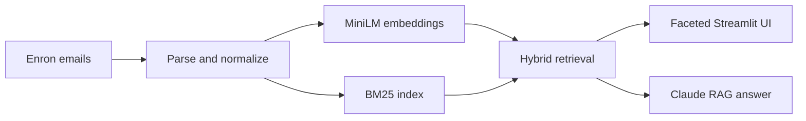

# Ask Your Emails

A Streamlit application for hybrid search and retrieval-augmented question
answering over **14,929 Enron emails**. It combines sentence-transformer
embeddings, BM25, faceted metadata filters, and Claude-generated answers with
the retrieved emails shown as evidence.


## System at a glance



## What I built

- a data pipeline that parses the Enron archive and builds a 14,929-email subset
- semantic retrieval with `all-MiniLM-L6-v2` embeddings and a persisted vector index
- optional BM25 plus semantic-score fusion for hybrid retrieval
- sender, recipient, and year filters in a unified Streamlit interface
- grounded answer generation that exposes the retrieved source emails

## Features

- **Hybrid retrieval:** semantic similarity and BM25 reduce vocabulary mismatch.
- **Faceted navigation:** narrow results by sender, recipient, and year.
- **RAG answers:** optionally synthesize a concise answer from the highest-ranked
  emails while retaining the sources for inspection.
- **Reproducible local index:** checked-in embeddings and index artifacts make the
  current demo loadable without rebuilding the corpus.

## Setup

```bash
git clone https://github.com/RishbhaJain/Ask-Your-Emails.git
cd Ask-Your-Emails

python3 -m venv .venv
source .venv/bin/activate
python -m pip install -r requirements.txt
cp .env.example .env
streamlit run app.py
```

Set `ANTHROPIC_API_KEY` in `.env` to enable generated answers. Search remains
available without it.

To rebuild the checked-in data and index:

```bash
python scripts/01_prepare_data.py
python scripts/02_build_index.py
```

## Evaluation snapshot

The repository includes a historical 50-question diagnostic at
`data/processed/eval_results_50.json`:

| Metric | Value |
|---|---:|
| Recall@10 | 0.58 |
| Precision@1 | 0.44 |
| MRR | 0.488 |
| Key-term match rate | 0.48 |
| Retrieval failure rate | 0.42 |

These numbers are a baseline, not a production claim. The script that generated
the historical artifact is not currently included, so the result is presented as
diagnostic evidence rather than a reproducible CI benchmark. A next step is to add
a versioned question set and evaluator before claiming metric improvements.

## Repository map

| Path | Purpose |
|---|---|
| `app.py` | Unified Streamlit search and RAG interface |
| `src/data_loader.py` | Dataset loading |
| `src/email_parser.py` | Email parsing and normalization |
| `src/embedder.py` | Sentence-transformer embeddings |
| `src/indexer.py` | Persisted vector index |
| `src/hybrid_search.py` | BM25 and semantic-score fusion |
| `src/search.py` | Retrieval orchestration and facets |
| `src/rag.py` | Claude answer generation from retrieved emails |
| `scripts/01_prepare_data.py` | Build the processed email subset |
| `scripts/02_build_index.py` | Generate embeddings and the local index |

## Limitations

- The Enron corpus is historical workplace email and does not represent a
  contemporary personal inbox or all communication styles.
- The checked-in evaluation is small and its original runner is not included.
- Generated answers require an Anthropic API key and should be verified against
  the displayed source emails.
- The current project is an educational prototype, not a multi-tenant system with
  authentication, access controls, or production data-governance guarantees.

Built as an INFO 202 final project at the UC Berkeley School of Information.
